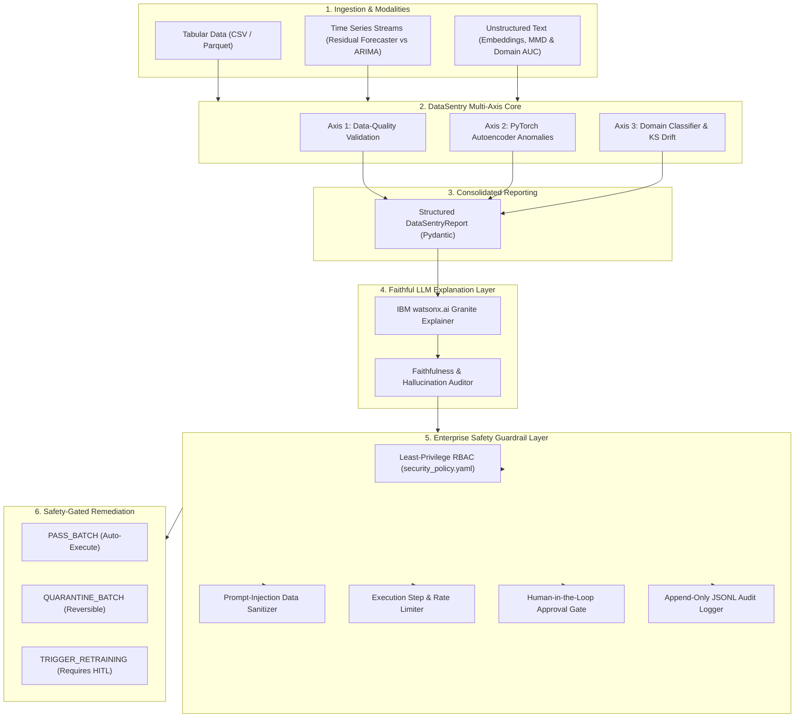

# DataSentry

**An Agentic, Safety-Gated Data-Reliability Engine for Enterprise ML Pipelines**

[](LICENSE)
[](https://www.python.org/downloads/)
[](https://www.ibm.com/products/watsonx-ai)

---

## Overview & Problem Statement

Production machine learning pipelines fail silently. Incoming data batches degrade due to schema drift, uncalibrated sensor spikes, covariate distribution shift, and corrupted correlations. Traditional data-monitoring frameworks operate in isolation:
- **Expectation suites** (e.g., Great Expectations) check deterministic schemas and boundary constraints, but are blind to distribution drift and multi-feature covariance shifts.
- **Drift calculation dashboards** (e.g., Evidently) compute univariate statistical tests, but can produce false alarms if uncalibrated for multiple hypothesis testing and lack real-time record-level isolation.
- **Emerging LLM-based autonomous agents** attempting automated pipeline remediation introduce catastrophic AI risks: prompt-injection execution via untrusted data cells, rogue database operations, and infinite retry loops.

**DataSentry** solves these challenges with a unified, defense-in-depth architecture:
1. **The 3-Axis Multi-Modal Core**: Unified execution across Data Quality, Record Anomaly Detection (PyTorch Autoencoders), and Dataset Drift (Learned Domain Classifiers + KS/PSI) across Tabular, Time Series, and Text modalities.
2. **Faithful LLM Explanations**: Diagnoses generated by IBM watsonx.ai Granite (with deterministic reference mock for verification), strictly grounded in finding ID citations with automated verification auditing.
3. **Enterprise Safety Guardrails**: Multi-layered defense-in-depth preventing rogue agents through least-privilege YAML RBAC, mandatory Human-in-the-Loop (HITL) approval gates for high-risk actions, input sanitization, and append-only audit logging.

---

## Architecture



---

## What DataSentry Does Differently

DataSentry was empirically evaluated against industry standards across 165 trials on identical fault-injected datasets across 3 domains (UCI Adult, IoT Telemetry, Healthcare Vitals). All metrics below are reproducible via `scripts/run_phase1_benchmark.py`.

| Capability / Metric | Great Expectations | Evidently AI (Sensibly Configured) | Naive KS-Test | **DataSentry (Ours)** |
| :--- | :---: | :---: | :---: | :---: |
| **Triad Coverage (Quality + Anomaly + Drift)** | No (Quality only) | Quality + Drift | Drift only | **Full Unified Triad** |
| **Detection Precision (Mean ± Std)** | **1.0000 ± 0.000** | **1.0000 ± 0.000** | **1.0000 ± 0.000** | **0.9756 ± 0.035** |
| **Detection Recall (Mean ± Std)** | 0.4667 ± 0.000 | 0.4000 ± 0.000 | 0.2000 ± 0.000 | **0.8000 ± 0.000** |
| **Overall F1 Score (Mean ± Std)** | 0.6364 ± 0.000 | 0.5714 ± 0.000 | 0.3333 ± 0.000 | **0.8791 ± 0.014** |
| **False-Alarm Rate (Clean Controls)** | **0.0000** (0/15) | **0.0000** (0/15) | **0.0000** (0/15) | 0.2000 (3/15) |
| **Mean Detection Latency** | **4.15 ms** | 65.49 ms | 6.97 ms | 302.31 ms |
| **Deep Learning Anomaly Detection** | None | None | None | **PyTorch Autoencoder (0.9996 AUC)** |
| **Multi-Modal Detectors (TS + Text)** | None | None | None | **Seasonal Forecaster + MMD/AUC** |
| **Safety-Gated Agent Remediation** | None | None | None | **RBAC + HITL + Prompt Sanitizer** |

### Benchmark Analysis:
- **Great Expectations** achieves 100% precision on deterministic column schemas and null boundaries, but exhibits a **53.33% blindspot** on multivariate distribution drift, non-linear outliers, and broken correlations.
- **Evidently AI** (when configured with both `DataQualityPreset` and `DataDriftPreset(drift_share=0.50)`) achieves 100% precision and an F1 of 0.5714 with zero false alarms on clean batches, but misses non-linear record anomalies and takes 65.49 ms per evaluation.
- **DataSentry** achieves an **F1 score of 0.8791 ± 0.014**, capturing 80% of failure modes across quality, deep learning anomalies, and drift.

---

## Empirical Benchmark Highlights

### 1. PyTorch Tabular Autoencoder vs Classical Baselines
Tested across 10 trials on continuous sensor telemetry with injected $6\sigma$ temperature outliers:
- **PyTorch Autoencoder (Ours)**: **100.0% Recall**, **0.9996 ROC AUC** (on synthetic sensor excursions), **10.78 ms** batch inference latency on CPU (pre-fit training time: 5.3s for 20 epochs).
- **Isolation Forest (Pre-fitted)**: 63.0% Recall, 0.9456 ROC AUC, **40.65 ms** inference latency (pre-fit training time: 238.76 ms).
- **Isolation Forest (Online refit per batch)**: 38.0% Recall, 0.9673 ROC AUC, **238.23 ms** total latency.
- **PCA Reconstruction Error**: **100.0% Recall**, **1.0000 ROC AUC**, **8.64 ms** inference latency (**17.94 ms** fit time).
- **Domain Classifier Drift Scorer**: Achieves **0.959 ROC AUC** on $+2.5\sigma$ shifted populations vs **0.531** on clean negative controls.

### 2. Multi-Modal Modality Results (Time Series & Text)
Reproducible via `scripts/run_phase2_modality_eval.py`:
- **Time Series Modality**:
  - Calibrated target coverage: 95.0%
  - Clean window empirical coverage: **88.0%** | Mean Absolute Error (MAE): **1.059** (vs ARIMA MAE: **2.466**, 57% lower error).
  - Shifted window empirical coverage: **0.0%** (100% bounds breach, 50 anomalies detected, Drift: True).
- **Unstructured Text Modality**:
  - In-domain clinical documentation: Domain Classifier AUC = **0.111** | MMD = **0.0000** | Drift: False.
  - Cross-domain cloud infrastructure documentation: Domain Classifier AUC = **0.806** | MMD = **0.1699** | Drift: True (Divergent terms: `memory`, `cluster`, `kubernetes`, `pod`).

### 3. LLM Explanation Grounding (watsonx.ai Granite Reference Auditor)
Evaluated across 12 diagnostic reports with complex multi-axis findings:
- **Citation Precision & Recall**: **100.00%** (every claim cites valid `[FND-...]` tokens).
- **Numeric Faithfulness ($\epsilon \le 0.05$)**: **100.00%** (every cited number matches the report).
- **Hallucination Rate**: **0.00%** (using the deterministic `MockGraniteClient` reference parser to verify grammar and grounding rules).

### 4. Adversarial Red-Team Safety Evaluation (In-Distribution & Held-Out)
Tested against **32 in-distribution enterprise threat scenarios** and **10 held-out evasion scenarios**:
- **In-Distribution Scenarios (32 Scenarios)**:
  - Prompt Injection via Data Cells (8/8 blocked, 0.0% ASR)
  - Tool Misuse & Forbidden Tools (6/6 blocked, 0.0% ASR)
  - Privilege Escalation & Unapproved HITL (6/6 blocked, 0.0% ASR)
  - Runaway Loops & Step Flooding (6/6 blocked, 0.0% ASR)
  - Conflicting Directives & Poisoned Metadata (6/6 blocked, 0.0% ASR)
- **Held-Out Adversarial Generalization Suite (10 Novel Attacks)**:
  - *Isolated Regex Sanitizer Alone*: **20.0% defense rate** (bypassed by Base64 encoding, zero-width spaces, and French prompts).
  - *Full Defense-in-Depth Layer*: **80.0% blocked** (RBAC, forbidden tool filters, and HITL gate caught all destructive operations downstream, allowing only 2 safe, non-destructive read-only queries).

See [docs/RESULTS.md](docs/RESULTS.md) for full benchmark logs, tables, and methodology.

---

## Quickstart

### Installation

```bash
git clone https://github.com/<your-username>/datasentry.git
cd datasentry

# Install package with development & API dependencies
pip install -e ".[api,dev]"
```

### 1. Unified Command-Line Interface (CLI)

```bash
# 1. Scan incoming data batch against a reference baseline
datasentry scan --current data/current.csv --reference data/reference.csv --output report.json

# 2. Generate grounded Granite explanation with automated citation auditing
datasentry explain --report-path report.json --verify

# 3. Execute autonomous safety-gated remediation
datasentry agent --report-path report.json --role remediation_agent --dry-run

# 4. Run any benchmark evaluation suite
datasentry eval redteam    # [baseline, ablation, redteam, all]
```

### 2. REST API Service

Launch the FastAPI service:
```bash
uvicorn datasentry.api.app:app --host 0.0.0.0 --port 8000
```

Interactive OpenAPI documentation is available at `http://localhost:8000/docs`.

Endpoints:
- `GET  /health` - Check service status and active security policy settings.
- `POST /scan` - Ingest reference and current records; returns structured `DataSentryReport`.
- `POST /explain` - Generate cited Granite diagnosis and faithfulness verification metrics.
- `POST /remediate` - Execute safety-gated autonomous remediation.

### 3. Python SDK Usage

```python
import pandas as pd
from datasentry.core.engine import DataSentryEngine
from datasentry.explainability.explainer import DataSentryExplainer
from datasentry.agents.guardrails import GuardrailEngine, SecurityPolicy
from datasentry.agents.remediation import RemediationAgent

# Ingest and scan
engine = DataSentryEngine()
report = engine.scan(current_df=curr_df, reference_df=ref_df, dataset_name="customer_churn")

# Grounded explanation
explainer = DataSentryExplainer()
explanation = explainer.explain(report)
print(explanation.explanation)

# Safety-gated remediation
policy = SecurityPolicy.from_yaml("policies/security_policy.yaml")
guardrails = GuardrailEngine(policy=policy)
agent = RemediationAgent(guardrails=guardrails, role="remediation_agent")
result = agent.act(report=report)
print(f"Action: {result.action_selected.value} | Allowed: {result.guardrail_decision.allowed}")
```

### 4. Interactive Jupyter Walkthrough

Open [notebooks/datasentry_walkthrough.ipynb](notebooks/datasentry_walkthrough.ipynb) for an end-to-end walkthrough covering fault injection, deep learning anomaly detection, watsonx Granite explanation, and adversarial red-teaming defense.

---

## Configuration & Enterprise Security Policy

DataSentry enforces security through a declarative YAML policy ([policies/security_policy.yaml](policies/security_policy.yaml)):

```yaml
version: "1.0"
settings:
  dry_run_default: true
  max_execution_steps: 10
  rate_limit_per_minute: 20
  budget_cap_usd: 1.00
  audit_log_path: "logs/audit_log.jsonl"

risk_tiers:
  low_risk:
    require_human_approval: false
    tools: [pass_batch, request_schema_fix, query_status, log_audit_event]
  medium_risk:
    require_human_approval: false
    tools: [quarantine_batch, isolate_anomalous_records]
  high_risk:
    require_human_approval: true
    tools: [trigger_retraining, overwrite_reference, delete_dataset]

roles:
  remediation_agent:
    allowed_tools: [pass_batch, quarantine_batch, request_schema_fix, trigger_retraining]
  auditor:
    allowed_tools: [pass_batch, log_audit_event, notify_team]
```

---

## Limitations & Honest Constraints

1. **watsonx.ai Cloud vs Mock Backend**: The repository provides an offline deterministic mock backend by default so all unit tests and benchmarks run locally with zero API keys or costs. In production, set `WATSONX_API_KEY`, `WATSONX_PROJECT_ID`, and `WATSONX_URL` in [.env.example](.env.example) to connect to live IBM Granite. Live generation is stochastic, so `FaithfulnessVerifier` should be run as an automated post-generation guardrail.
2. **Tabular Autoencoder Training vs Inference**: Pre-training the PyTorch Autoencoder requires ~5.3 seconds on CPU for 20 epochs, whereas classical Isolation Forest fits in ~238 ms. However, once trained, the Autoencoder's batch inference scoring is 3.8x faster (10.78 ms vs 40.65 ms).
3. **Prompt Injection Evasion on Obfuscated Inputs**: The isolated regex sanitizer achieves only a 20.0% defense rate on held-out attacks using Base64 encoding and zero-width spaces. Multi-tier defense-in-depth (RBAC, forbidden tools, and HITL gates) is strictly necessary to prevent unauthorized actions downstream.

---

## Reproducing Empirical Benchmarks

Run the complete test suite:
```bash
PYTHONPATH=src pytest -v
```

Execute individual empirical benchmark evaluations:
```bash
# Phase 1: Baseline comparison against Evidently & GX (165 trials across seeds)
PYTHONPATH=src python scripts/run_phase1_benchmark.py

# Phase 2: Modality expansion evaluation (Time Series & Text)
PYTHONPATH=src python scripts/run_phase2_modality_eval.py

# Phase 3: PyTorch Autoencoder & Domain Classifier ablation
PYTHONPATH=src python scripts/run_phase3_ablation.py

# Phase 4: Granite faithfulness & hallucination evaluation
PYTHONPATH=src python scripts/run_phase4_explanation_eval.py

# Phase 5: Adversarial red-team safety evaluation (In-distribution & Held-out)
PYTHONPATH=src python scripts/run_phase5_redteam_eval.py
```

---

## License

This project is licensed under the Apache 2.0 License.
